  

I'm a **full-stack  developer** with professional experience developing and maintaining web applications, REST APIs and databases. 

🌐 **[Developer portfolio](https://tere2087.github.io/)**

Alongside development, I'm studying for a **Master's in Cybersecurity**, exploring how software behaves under authorized security testing and how to make applications more robust.

- 💻 **Development:** PHP, Laravel, Symfony, Python, Angular, TypeScript and SQL
- 🔧 **Interests:** backend architecture, API integrations and automation
- 🛡️ **Security:** secure coding, web/API security, ethical hacking and hands-on labs
  
## 🎓 Education & Experience

- 🎓 **Higher Technician in Multi-platform Application Development (DAM)** 
- 🎓 **Master's in Cybersecurity**  in progress (expected June 2027)
- 💼 **Full-Stack / Backend Developer** professional experience with web applications, APIs and databases
  

## 💻 Languages & Frameworks

  
  
  
  
  
  
  
  
  

## 🗄️ Databases

  
  
  
  

## 🧰 Tools & Technologies

  
  
  
  
  

## 🎯 Current Focus

- Building and maintaining full-stack/backend applications
- Always learning, growing, and improving.
- Studying web and API security, authorization and secure coding
- Improving Python automation, tests and software maintainability

## 📫 Contact

📧 **tecaherdev@gmail.com**  

  <i>"Understanding how systems break is the first step to building them better."</i>

